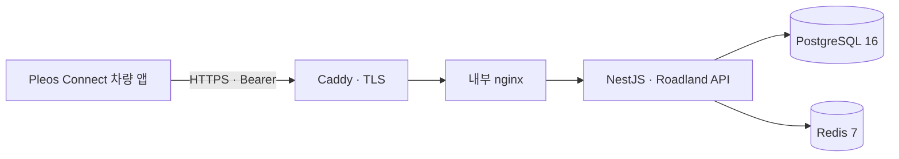

# Roadland 서버

**안전한 운전으로 넓히는 나의 영토**

로드랜드 차량 앱의 안전 주행 보상, 영토 소유권, 개인 레벨, 크레딧 정산을 담당하는 NestJS 서버입니다. 차량에서 받은 주행 요약을 검증하고 PostgreSQL 트랜잭션으로 잔액과 소유권을 관리합니다.

- [차량 앱 저장소·실행 환경](https://github.com/doyeonism/hyundai-app-roadland)
- [서명된 release APK](https://github.com/doyeonism/hyundai-app-roadland/tree/main/apk)
- [데이터 보관·삭제·정산 정책](docs/roadland-data-policy.md)
- 기본 차량 API: `https://roadland.doyeonism.com/api/roadland/v1/car`

## 구조



| 경로 | 역할 |
|---|---|
| `apps/api/src/roadland/controllers` | 차량 API·개발 시연 API |
| `apps/api/src/roadland/services` | 인증·정산·구매·개인 레벨·개인정보 처리 |
| `apps/api/src/roadland/domain` | 보상 규칙·타일 좌표·시간 계산 |
| `packages/database` | Prisma 스키마·마이그레이션·DB 클라이언트 |
| `packages/shared` | 앱·서버 요청 및 응답 타입 |
| `apps/web`, `apps/admin`, `packages/ui` | 웹·관리자 기반 코드. 현재 기본 배포 대상에서 제외 |
| `ci/docker-composes`, `ci/dockers`, `ci/nginx`, `ci/edge` | 개발·테스트·운영 컨테이너 및 프록시 설정 |
| `.github/workflows/build_and_deploy.yml` | 테스트·GHCR 빌드·운영 배포 |

NestJS 11, Prisma 7, TypeScript, pnpm workspace와 Turborepo를 사용합니다. 정확한 의존성 버전은 각 `package.json`과 `pnpm-lock.yaml`을 기준으로 합니다.

## 실행 준비

- Node.js 22(CI 기준), pnpm **10.10.0**
- Docker와 Docker Compose v2
- `make`를 사용할 수 있는 Linux·WSL 또는 호환 환경. Windows에서는 Docker Desktop과 WSL 사용 가능
- PostgreSQL 16, Redis 7은 Compose로 기동

```bash
git clone git@github.com:doyeonism/hyundai-app-roadland-server.git
cd hyundai-app-roadland-server
corepack enable
pnpm install --frozen-lockfile
cp envs/.env.example envs/.env.dev
```

`envs/.env.dev`를 다음 기준으로 설정합니다. 예제의 비밀번호와 JWT 자리표시자는 실제 로컬 값으로 바꾸세요. 운영 환경과 같은 비밀번호를 쓰지 않습니다.

| 변수 | 설정 기준 |
|---|---|
| `NODE_ENV` | 로컬은 `development`, 운영은 `production` |
| `PROJECT_NAME` | 앱의 기본 URL과 맞추려면 `roadland`. API 경로와 컨테이너명에도 사용 |
| `NETWORK_NAME` | 환경별로 구분한 Docker 네트워크명 |
| `POSTGRES_USER`, `POSTGRES_PASSWORD`, `POSTGRES_DB` | 로컬 DB 계정·비밀번호·DB 이름 |
| `SERVER_PORT`, `DB_PORT` | 기본 API 3000, DB 5432. 충돌 시 변경 |
| `REDIS_HOST`, `REDIS_PORT`, `REDIS_PASSWORD` | 컨테이너 내부 호스트·포트는 Compose가 주입. 호스트에서 실행할 때는 실제 연결 주소 지정 |
| `ACCESS_JWT_SECRET`, `REFRESH_JWT_SECRET`, `SIGN_UP_JWT_SECRET` | 공통 인증 모듈의 환경 검증에 필요. 차량 Bearer 토큰과는 별도 |
| `COOKIE_DOMAIN` | localhost 개발에서는 비워 두기 |
| `ALLOWED_ORIGINS` | 실제로 허용할 웹 오리진만 설정 |
| `API_PUBLIC_URL`, `WEB_PUBLIC_URL` | 외부에서 접근하는 주소. 웹 관련 선택 기능 사용 시 맞춤 설정 |

전체 변수와 선택 기능은 [환경 예제](envs/.env.example)를 참고하세요. `NEXT_PUBLIC_` 변수는 브라우저에 노출될 수 있으므로 비밀정보를 넣지 않습니다.

## 개발 환경 실행

```bash
pnpm run db:generate
make dev
```

현재 기본 개발 Compose는 **API·PostgreSQL·Redis**를 기동합니다. API 컨테이너는 Prisma 생성, 마이그레이션 적용, database → shared 빌드를 수행한 후 watch 모드로 실행합니다. 웹·관리자·nginx 서비스는 개발 Compose에서 주석 처리되어 있습니다.

`PROJECT_NAME=roadland`, `SERVER_PORT=3000`일 때:

- 헬스 체크: `http://localhost:3000/api/roadland/v1/health`
- 차량 API: `http://localhost:3000/api/roadland/v1/car`
- Android 에뮬레이터에서 호스트 API: `http://10.0.2.2:3000/api/roadland/v1/car`

차량 앱의 로컬 API 지정 방법은 [앱 README](https://github.com/doyeonism/hyundai-app-roadland#readme)에 있습니다. `10.0.2.2`는 Android 에뮬레이터의 호스트 접근용 주소입니다.

```bash
docker compose -p roadland --env-file envs/.env.dev -f ci/docker-composes/docker-compose.dev.yaml logs -f server
```

프로젝트명을 다르게 설정했다면 `-p` 값도 맞춥니다. 종료·정리는 Makefile의 동작을 먼저 확인하세요. **`make clean`은 DB 볼륨을 삭제하므로 운영 업데이트나 초기 설정의 기본 절차로 사용하지 않습니다.**

## 인증과 주요 API

차량 = 계정인 MVP입니다. `POST /devices`로 무작위 토큰을 발급하고 이후 `Authorization: Bearer <token>`으로 요청합니다. DB에는 토큰의 SHA-256 해시만 저장하며 Redis도 토큰 해시를 키로 사용합니다. 토큰 원문은 차량 앱이 보관합니다. 재설치 시 기존 차량 계정 복구는 별도 해결 과제입니다.

다음 경로는 `/api/roadland/v1/car` 기준입니다.

| 메서드·경로 | 기능 |
|---|---|
| `POST /devices` | 차량 등록·토큰 발급 |
| `POST /privacy/consent` | 동의 버전 기록 |
| `GET /home` | 잔액·개인 레벨·수익·오늘 주행 요약 |
| `POST /trips` | `clientTripId` 기반 중복 방지 주행 정산 |
| `GET /territory` | 방문 영역·소유권·구매 가능 여부 |
| `POST /tiles/:id/buy` | 방문·재방문 조건과 잔액을 확인한 땅 구매 |
| `POST /profile/upgrade` | 개인 레벨업. `expectedLevel`로 현재 레벨 확인 |
| `POST /collect` | 누적 소유지 수익 수령 |
| `GET /records` | 안전 점수·연속 기록 |
| `GET /ranking` | 소유한 땅 수·주간 주행 순위 |
| `DELETE /profile` | 차량 계정과 종속 데이터 삭제 |

등록을 제외한 위 차량 API에는 차량 토큰이 필요합니다. 과거 `POST /tiles/:id/upgrade`는 현재 개별 땅 업그레이드를 수행하지 않으며 개인 레벨업 이용을 안내합니다. 차량 앱의 UI·문서와 서버 버전이 다르면 이 계약을 확인하세요.

## 안전 운전과 정산

- 급제동·차량 안전 경고가 기록된 타일은 주행 보상에서 제외합니다.
- 안전 구간 기본 보상은 타일당 40크레딧, ECO·크루즈 추가 보상은 50%, 방향지시등 사용률 80% 이상인 차선 변경 주행의 매너 보너스는 20%입니다.
- 안전 점수 90점 이상인 유효 주행은 안전 연속 기록에 반영합니다. 하루 주행 보상은 서울 날짜 기준 최대 8,000크레딧입니다.
- 시간·평균 속도·거리 대비 타일 수·타일 연속성·주행 시간 겹침을 검증합니다. 이는 입력의 일관성 검증이며 실제 교통법규 준수 전체를 인증하지 않습니다.
- 같은 차량의 같은 `clientTripId`는 저장된 정산 결과를 반환합니다. 차량별 Redis 잠금과 DB 행 잠금·트랜잭션으로 잔액·원장·소유권 변경을 처리합니다.
- 개인 레벨업은 기존 잔액으로 비용을 결제하고, 기존 레벨에서 발생한 수익을 정산한 후 레벨을 올립니다. 개인 레벨 상승 시 모든 소유지의 하루 수익이 1씩 증가합니다.
- 소유지 수익은 개인 레벨과 경과 시간에 따르며 안전 점수 미달로 모두 차단되는 구조는 아닙니다. 안전 관련 방문 통계와 수익 계산을 구분합니다.

현재 수치와 판정은 [보상 규칙](apps/api/src/roadland/domain/rules.ts), [게임 서비스](apps/api/src/roadland/services/game.service.ts), [데이터·정산 정책](docs/roadland-data-policy.md)을 기준으로 합니다. 주행 중 화면 제한과 차량 신호 기반 점수 계산은 차량 앱이 담당합니다.

## 데이터와 개인정보

원본 GPS 좌표 대신 약 10m 타일과 주행 요약을 받습니다. 타일도 생활 동선을 추정할 수 있는 데이터로 취급합니다.

- 주행별 상세 타일: 90일 후 비움
- 날짜별 방문: 서울 기준 최근 7일 유지
- 구매·재방문 자격용 방문 타일과 마지막 통과 시각: 계정 삭제까지 보관
- 주행 요약·중복 정산 키·크레딧 원장: 계정 삭제까지 유지
- 삭제 API: 차량·종속 DB 데이터, 인증 캐시 및 랭킹 정리

백업 파일의 별도 보존·만료 정책은 아직 확정이 필요합니다. 자세한 조건과 운영 과제는 [데이터 정책](docs/roadland-data-policy.md)에 정리했습니다. 시각은 UTC로 저장하고 일일 정산 날짜는 서울 기준으로 계산합니다.

## 테스트와 빌드

CI와 동일한 의존 패키지 준비 순서입니다.

```bash
pnpm --filter @roadland/database db:generate
pnpm --filter @roadland/database build
pnpm --filter @roadland/shared build
pnpm --filter api test -- --runInBand
pnpm --filter api test:e2e
pnpm api:build
```

테스트는 `envs/.env.test`의 더미 설정을 사용합니다. E2E는 Docker가 필요하며 격리된 PostgreSQL 5433·Redis 6380을 기동하고 종료 시 테스트 볼륨을 정리합니다. 해당 포트가 다른 서비스와 충돌하지 않아야 합니다. README 정리 작업에서 위 테스트 전체를 새로 실행한 것으로 간주하지 마세요.

## 운영 배포

```bash
cp envs/.env.example envs/.env.prod
# 환경별 비밀값, NODE_ENV=production, 도메인, 이미지 설정 입력
make prod
```

`IMAGE_PREFIX=ghcr.io/doyeonism/hyundai-app-roadland-server`와 필요한 이미지 태그·레지스트리 인증을 설정합니다. GitHub Actions는 테스트 후 현재 배포 대상인 **api** 이미지를 GHCR에 게시하고, 운영 서버는 이미지를 pull하여 컨테이너를 교체합니다. GitHub 저장소·패키지 권한과 배포 Secrets는 별도로 설정해야 하며 README push만으로 배포 구성이 완성되지는 않습니다.

외부 HTTPS는 [Caddy 설정](ci/edge), 내부 라우팅은 [nginx 설정](ci/nginx)을 사용합니다. Caddy와 프로젝트 nginx가 동일한 edge 네트워크에 연결되고 upstream 이름이 실제 컨테이너명과 일치해야 합니다. API 컨테이너 기동 시 DB 마이그레이션을 적용하므로 운영 업데이트 전 백업과 마이그레이션 내용을 확인합니다.

`NODE_ENV=production`에서는 개발 라우트를 등록하지 않으며 시간 가속도 비활성화합니다. 스테이징 도구는 `ROADLAND_DEV_TOOLS=true`, `ROADLAND_DEV_TOKEN` 및 `x-roadland-dev-token` 인증을 함께 사용합니다. 인증키 없는 개발·테스트 도구를 외부에 공개하지 않습니다.

## 보안과 라이선스

실제 `.env`, 개인 키·인증서·keystore, DB 백업, 의존성과 빌드 결과는 Git/Docker 제외 규칙으로 관리합니다. `envs/.env.example`과 테스트 전용 더미 `envs/.env.test`만 추적합니다. 새 비밀값을 커밋하기 전에 추적 상태와 과거 이력을 함께 확인하고, 유출 시 키 교체를 우선합니다. 과거 커밋에 남은 작성자 개인 이메일은 현재 파일의 제외 규칙과 별개입니다.

이 저장소의 프로젝트 전체 재사용 라이선스는 별도 지정하지 않았으며 API 패키지는 `UNLICENSED`로 표시되어 있습니다. NestJS·Prisma·Redis·PostgreSQL 등 의존성과 컨테이너 이미지의 사용·재배포 조건은 각 버전의 라이선스에 따릅니다. 이 README는 전체 서버 의존성의 라이선스 고지를 대신하지 않습니다.
